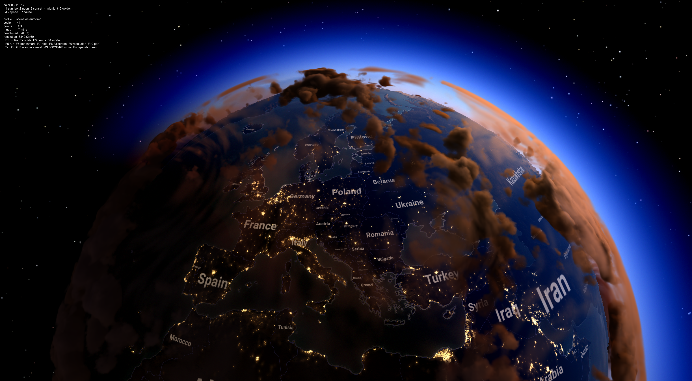

# Physically Based Atmosphere and Clouds for Strategy Games
This repository uses Sebastian Lague's _Geographical Adventures_ and, to a lesser degree, _Coding Adventure: Clouds_ projects as a base. Check his work out, it's great.

The aim of this project is to explore how physically based rendering techniques for the sky, atmosphere and clouds can be used in the context of a strategy game. These techniques, as described by Hillaire, Bruneton, Schneider and others, are usually implemented with more traditional first- or third-person perspective games in mind. What considerations do you need to take if trying to use them in a strategy game where the camera has a top down angle, the scale is much larger and so on? What limitations or opportunities are there?

The project is being done as part of a master's thesis in computer science at KTH.

The project currently features a globe with country labels and borders as a base. It then renders the atmosphere, sky, clouds on top of that. There are multiple settings to control this, including time controls, render flags, benchmarking tools, etc.

#### Status
The project is a work in progress.

### Disclaimer
To assist in porting the techniques described by Hillaire, Bruneton, Schneider to the Unity project base by Lague, LLM-based code assistance (Claude Code) was used in the initial phase and then iterated upon manually.

### Requirements
The project uses Unity v6000.3.21f1.

### License
MIT. See LICENSE. Based on work by Sebastian Lague.

## Main References
- Hillaire, S. (2020). [A Scalable and Production Ready Sky and Atmosphere Rendering Technique](https://onlinelibrary.wiley.com/doi/10.1111/cgf.14050). *Computer Graphics Forum* 39(4), 13–22.
- Hillaire, S. (2016). [Physically Based Sky, Atmosphere and Cloud Rendering in Frostbite](https://media.contentapi.ea.com/content/dam/eacom/frostbite/files/s2016-pbs-frostbite-sky-clouds-new.pdf). SIGGRAPH.
- Hillaire, S. (2020). [Physically Based and Scalable Atmospheres in Unreal Engine](https://www.youtube.com/watch?v=SW30QX1wxTY). SIGGRAPH talk.
- Bruneton, E. (2017). [Precomputed Atmospheric Scattering: A New Implementation](https://ebruneton.github.io/precomputed_atmospheric_scattering/).
- Schneider, A. and Vos, N. [The Real-Time Volumetric Cloudscapes of Horizon Zero Dawn](https://www.guerrilla-games.com/read/the-real-time-volumetric-cloudscapes-of-horizon-zero-dawn). Guerrilla Games.
- Lague, S. [Geographical Adventures](https://github.com/SebLague/Geographical-Adventures).
- Lague, S. (2019). [Coding Adventure: Clouds](https://www.youtube.com/watch?v=4QOcCGI6xOU).